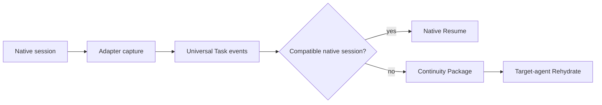

# Adapter Protocol

An adapter declares discovery, capture, Artifact, Native Resume and Rehydrate capabilities. Every adapter must capture portable events and support either Native Resume or Rehydrate. Generic and Codex adapters run the shared compatibility test.

Adapters may retain native session references but must not claim private runtime equivalence. Filesystem or structured-log capture is experimental where no vendor API exists; UI scraping is not a primary integration. The shared mainstream structured-log core recognizes provider-specific session records plus user/Agent messages, tool calls/results, decisions, status, errors, and file/Artifact changes while deliberately discarding private reasoning records.
