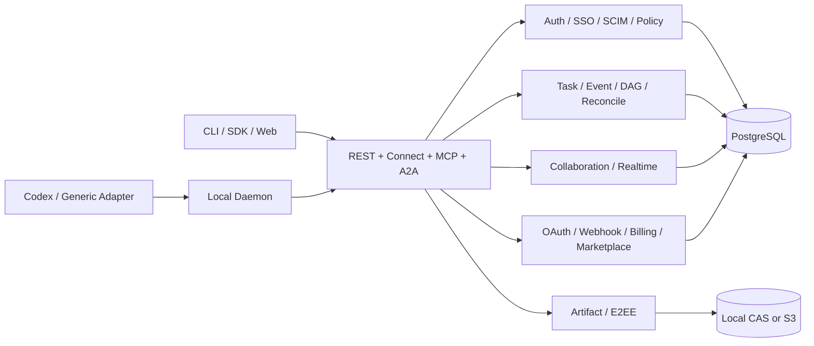
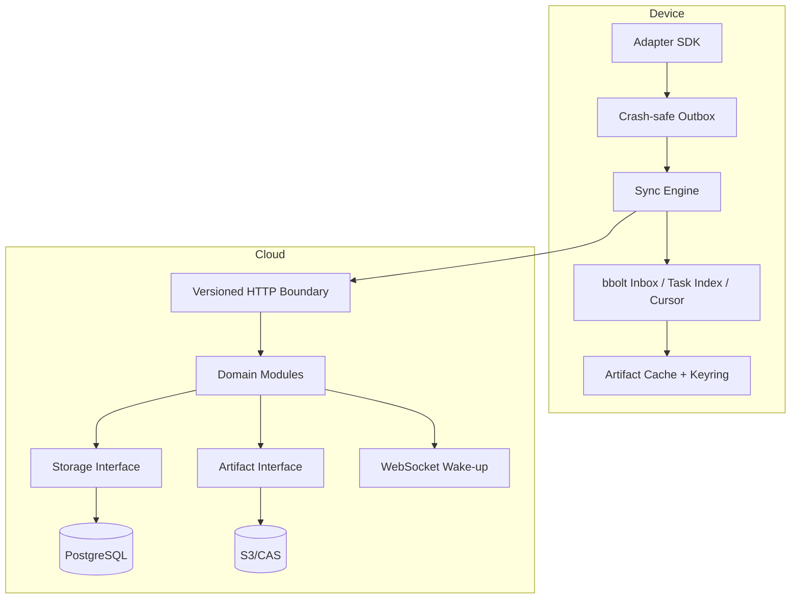

# Architecture

The server is a modular monolith because Event acceptance, permission evaluation, idempotency and causal-head updates require one transactional boundary. Modules communicate through storage, Artifact, policy, identity, webhook and observability interfaces, so measured scaling pressure can extract workers without changing the public protocol.

PostgreSQL is the authority for identity, permissions, metadata, Events, cursors, conflicts and durable webhook delivery state. The database Event Log is also the reconstructable durable source behind notifications, so an external event bus is optional rather than a correctness dependency. Artifact bytes remain outside relational rows.

S3 mode stores resumable chunks as immutable hash-addressed temporary objects, allowing any API replica to continue or assemble an upload. Per-pod disk is only an expendable cache; local mode uses a retained PVC. Realtime is never authoritative. E2EE payloads and Artifact ciphertext are opaque to the server.

Production uses external PostgreSQL/PITR, versioned object storage, TLS ingress, external secrets, three or more stateless API replicas, HPA/PDB/topology controls, explicit egress policy and managed telemetry. The in-chart PostgreSQL exists only for local/dev acceptance.
