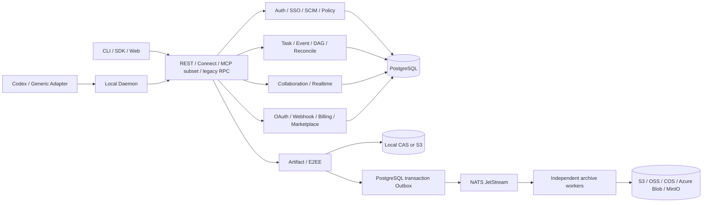
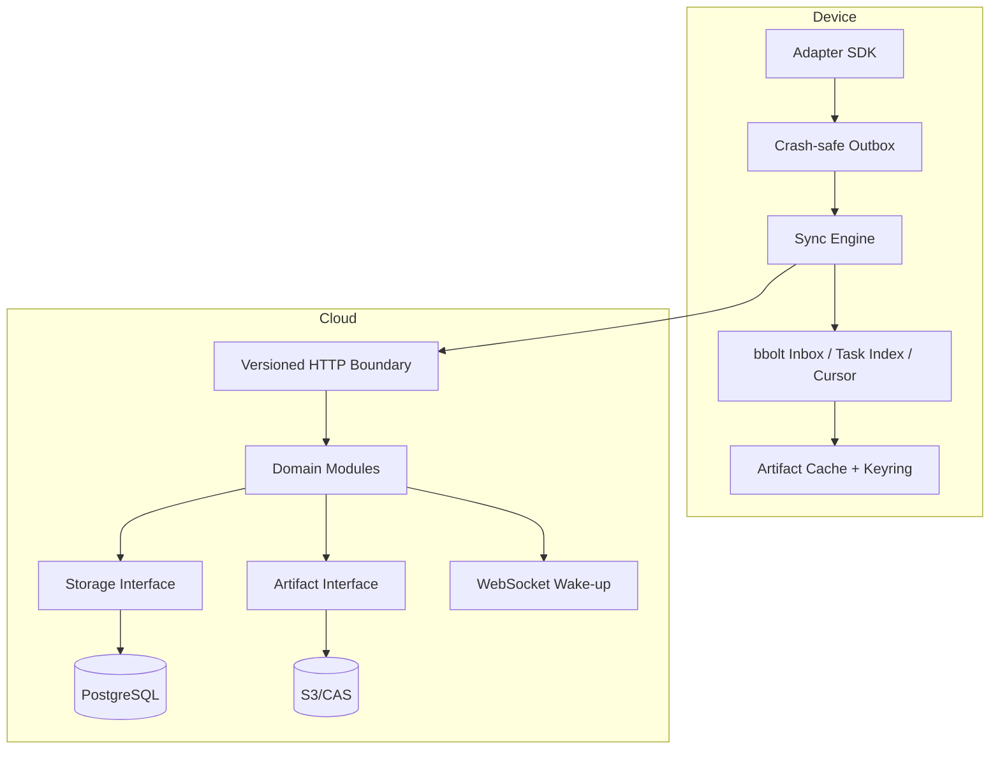

# Architecture

The server is a modular monolith because Event acceptance, permission evaluation, idempotency and causal-head updates require one transactional boundary. Modules communicate through storage, Artifact, policy, identity, webhook and observability interfaces, so measured scaling pressure can extract workers without changing the public protocol.

PostgreSQL is the authority for identity, permissions, metadata, Events, cursors, conflicts and durable webhook delivery state. New Event consumption and the Event commit in one transaction, independently of HTTP/MCP/sync transport. HTTP audit/webhook enqueue and other mutation meters still have post-commit failure boundaries. Realtime notifications are repaired by cursor pull. Enabled asynchronous archival requires JetStream; PostgreSQL is its transactional Outbox, not the message broker. Artifact bytes remain outside relational rows.

Direct S3 mode supports replica-safe resumable chunks. Current asynchronous-archive production values instead use shared RWX/POSIX staging between API and workers; until confirmed archive receipt, this staging is durable pending data, not disposable cache. Lifecycle may evict archived cached bytes only under retention/locking rules. E2EE ciphertext remains opaque. Outbox + JetStream + idempotent workers gives eventual consistency, not cross-cloud XA.

Production uses external PostgreSQL/PITR, versioned object storage, TLS ingress, external secrets, three or more stateless API replicas, HPA/PDB/topology controls, explicit egress policy and managed telemetry. The in-chart PostgreSQL exists only for local/dev acceptance.
