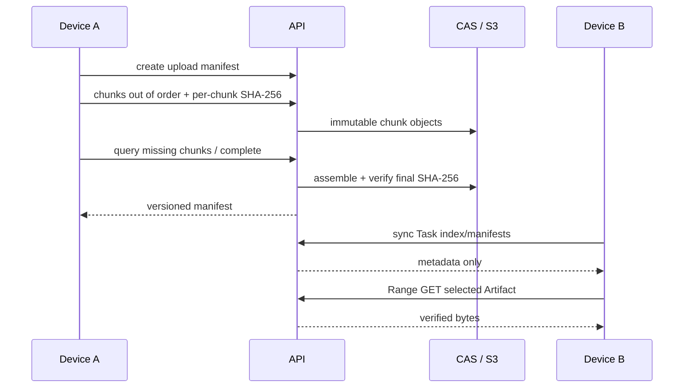

# Artifact Protocol

Artifacts are typed, versioned resources rather than strings. A manifest records Artifact/Task/version/parent identity, MIME type, filename, size, content and chunk-manifest hashes, producer/device, metadata, encryption metadata and storage reference. Source, image, audio, video, PDF, Office, archive, patch, directory/reference, binary and custom MIME types use the same envelope.

Direct upload and resumable upload both stream through bounded readers, verify SHA-256, fsync temporary files and publish only complete content. Resumable sessions expose received/missing chunks, permit out-of-order retry and require the expected current parent version. Local storage uses `sha256/<prefix>/<digest>`. S3 storage uploads hash-addressed chunks immediately, assembles from any replica and verifies downloaded cache entries before serving.

Client-side Artifact E2EE uses an Artifact DEK derived/wrapped under the Task key, AES-256-GCM per chunk, plaintext/ciphertext digests and authenticated metadata. The server stores ciphertext and cannot silently substitute content. Local cache writes are atomic and a failed or hash-mismatched download never publishes the destination.

Optional direct P2P transfer uses a short-lived random bearer, bounded listener policy, resumable Range fetch and end-to-end hash verification; cloud transfer remains the fallback and authority for manifests.
