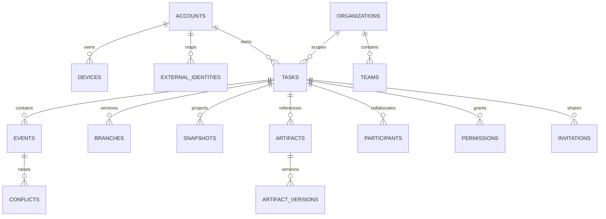

# Database Design

PostgreSQL is transactional truth. Nine additive migrations are embedded and executed under an advisory lock:

| Version | Domain |
|---|---|
| 001 | accounts, devices, Tasks, explicit permissions, Events, conflicts, Artifacts, invitations |
| 002 | refresh sessions, API keys and audit |
| 003 | branches, merges/resolutions and snapshots |
| 004 | resumable Artifact uploads/chunks/versions |
| 005 | Agents, participants/bindings and notifications |
| 006 | sync nonce/cursor state and E2EE Task keys |
| 007 | Organizations, Teams, policy, Artifact ACL, OAuth and webhooks |
| 008 | usage, billing and marketplace ledgers |
| 009 | external OIDC/SCIM identity mapping |

Opaque random IDs and uniqueness on Event ID, `(task,device,sequence)`, idempotency, sync nonce, one identity-provider subject and marketplace/usage keys enforce replay/idempotency at storage level. Event append uses serializable transactions to lock Task heads, assign server sequence, record conflicts and update branches atomically. Reads use Task/cursor/activity indexes; Artifacts are immutable metadata pointing to verified CAS/S3 bytes.

Upgrade policy is expand → compatible deploy → backfill → observe → contract. Down files document development reversal but production never automatically destroys durable state. At larger scale, Events can be time/range partitioned and archived after verified snapshots without changing Task-local cursor/DAG semantics.
