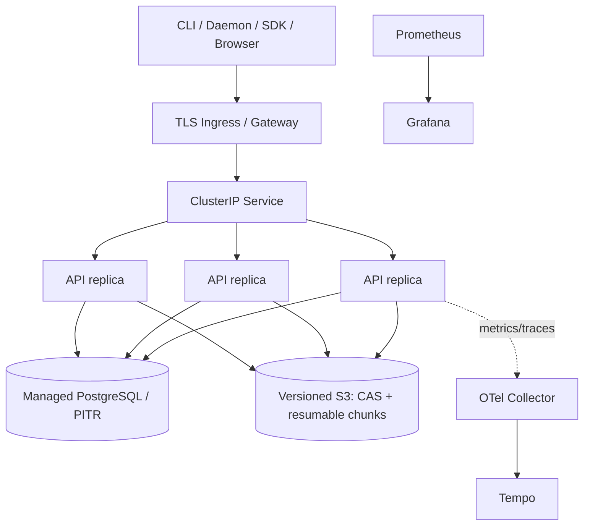

# Deployment

Four executable modes are supported: dependency-free memory development, isolated PostgreSQL/MinIO/observability Compose integration, Kubernetes dev/staging, and a production Helm profile using external PostgreSQL and S3.

The chart renders Deployment, Service, optional Ingress, ConfigMap, existing Secret references, ServiceAccount/RBAC, HPA, PDB, NetworkPolicy, ServiceMonitor/PrometheusRule, migration Job, optional backup CronJob and development PostgreSQL. It includes startup/readiness/liveness probes, graceful termination, rolling update with zero unavailable, anti-affinity/topology options and explicit external egress CIDRs.

Local Artifact mode uses a retained RWO PVC and the chart rejects local storage with multiple replicas or HPA. Staging and production profiles use S3; resumable chunks are immutable hash-addressed objects and each Pod uses `emptyDir` only as expendable staging/cache, so requests may route to any replica. Production values disable in-chart PostgreSQL, use three replicas/HPA/PDB and require the example S3/TLS/secrets/egress values to be replaced with real endpoints. The migration Job renders for both in-chart and external PostgreSQL.

Rancher Desktop scripts validate an explicit loopback `rancher-desktop` context and node identity, never switch the current context, preserve the existing Secret/PVC, perform rollback-on-failure and execute the release E2E through a local port-forward. The local image ID is included in the Pod template so rebuilding the same `:dev` tag still creates a new ReplicaSet. Generic staging/production deployment requires explicit operator context and approval; the local safety script intentionally refuses it.
