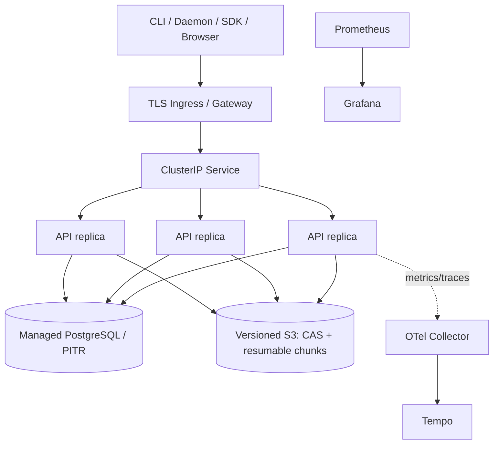

# Deployment

Four modes exist: memory development, isolated Compose integration, Kubernetes dev/staging, and production Helm profiles. Current async-archive profiles use external PostgreSQL, shared RWX/POSIX staging, TLS JetStream and a selectable cloud archive provider. See [cloud delivery](multicloud-deployment.zh-CN.md); templates passing render are not real-cloud acceptance.

The chart renders Deployment, Service, optional Ingress, ConfigMap, existing Secret references, ServiceAccount/RBAC, HPA, PDB, NetworkPolicy, ServiceMonitor/PrometheusRule, migration Job, optional backup CronJob and development PostgreSQL. It includes startup/readiness/liveness probes, graceful termination, rolling update with zero unavailable, anti-affinity/topology options and explicit external egress CIDRs.

Single-node local mode uses retained RWO PVCs. Multiple API/worker replicas in asynchronous-archive mode require the shared RWX claim and cross-node POSIX locks; unarchived bytes must survive Pod loss. Direct S3 backend is an alternate mode, not the current production values default. Production disables in-chart PostgreSQL, uses three replicas/HPA/PDB and needs site-specific TLS/secrets/egress/backup values. Migration works with internal or external PostgreSQL.

Rancher Desktop scripts validate an explicit loopback `rancher-desktop` context and node identity, never switch the current context, preserve the existing Secret/PVC, perform rollback-on-failure and execute the release E2E through a local port-forward. The local image ID is included in the Pod template so rebuilding the same `:dev` tag still creates a new ReplicaSet. Generic staging/production deployment requires explicit operator context and approval; the local safety script intentionally refuses it.
