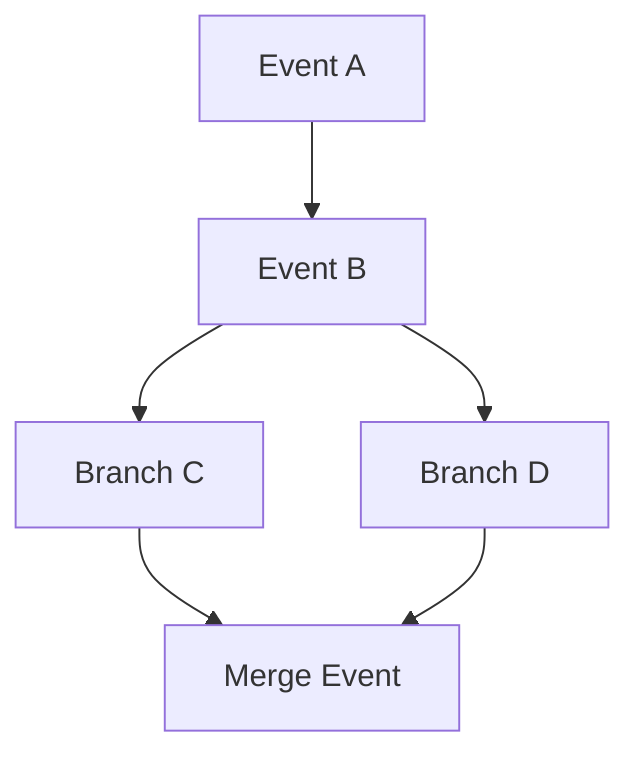

# Domain Model

`Account` owns devices and Tasks. A `Device` has an Ed25519 public key and revocation timestamp. A `Task` has an objective, status and a set of causal heads. An append-only `Event` contains producer identity, branch, parents, HLC, device and server sequences, digest, optional payload references, signature, and idempotency key. `Artifact` separates immutable bytes from versioned metadata. `Invitation` materializes a time-bounded capability into a Task permission.

Task heads are the events with no known children. Out-of-order arrival is allowed: an unknown parent is retained as a conflict, and when it arrives later it is not incorrectly promoted to a head if its child is already stored. Merge is always a new event with all merged heads as parents, preserving provenance.
