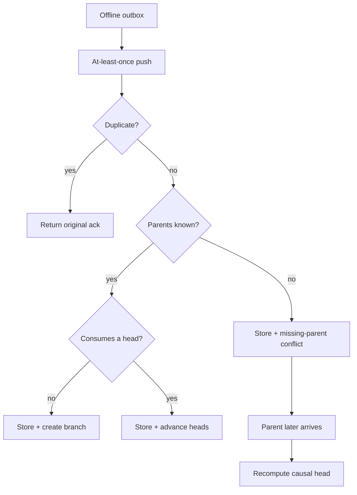

# Reconciliation

Reconciliation is a dedicated module and store transaction, not timestamp overwrite logic. It classifies duplicates, sequence replay, missing parent, non-conflicting concurrency, branch conflict, permission conflict, Artifact version conflict, and delete-versus-update.

No valid signed work is silently discarded. Auto-merge is limited to structurally non-conflicting events. Semantic and Artifact conflicts require an explicit merge/resolution event; provenance remains queryable.
