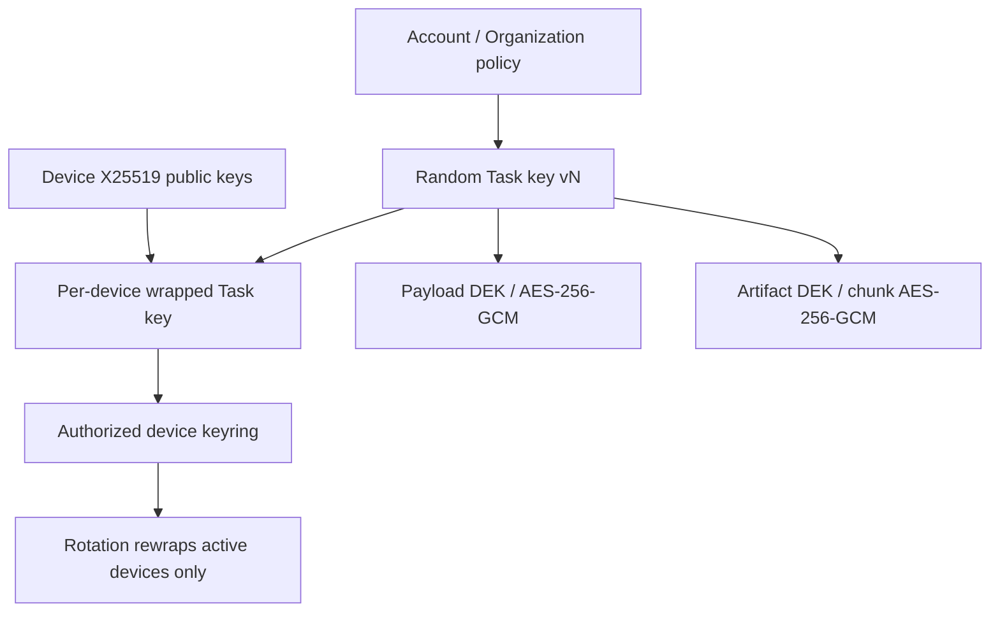

# Security Architecture

Authentication supports short-lived access tokens, one-time rotated refresh sessions with family replay revocation, scoped API keys, OAuth client credentials and OIDC RS256/JWKS exchange. Device identity is Ed25519 for Events/sync/QR signatures and X25519 for Task-key envelopes. Device revocation blocks new Events and key grants immediately.

Authorization combines scope checks, explicit Task read/write/admin ACL, per-Artifact ACL, Organization/Team RBAC, ordered ABAC allow/deny policy, Agent ownership/capabilities and single-use invitation capabilities. Every sensitive mutation emits structured audit provenance. Rate limits, bounded decoders, SSRF-safe webhooks, traversal prevention, hash verification and non-root/read-only containers reduce abuse impact.

Event and Artifact plaintext can be encrypted before upload. Associated data binds ciphertext to Event/Artifact identity; plaintext and ciphertext digests detect substitution. The cloud stores opaque encrypted payloads and wrapped keys but not device private keys. Revocation prevents future access but cannot erase plaintext or keys previously copied by a legitimate device; rotation limits future exposure.

QR invitations contain only a high-entropy, short-lived one-time reference. The referenced record binds invitation, Task, inviter/device, scope, expiry, nonce, key-exchange reference and device signature. The server stores only token digest, rejects nonce/token replay, prevents admin escalation and supports invitation plus resulting Task-permission revocation.

Enterprise Organization records express `platform`, `byok`, `kms` or `hsm` key policy and deployment residency. Real Cloud KMS/HSM custody, public TLS, external secrets/Vault and compliance attestations require the target operator's accounts and are release-environment validations; they are not emulated as cryptographic custody claims.
