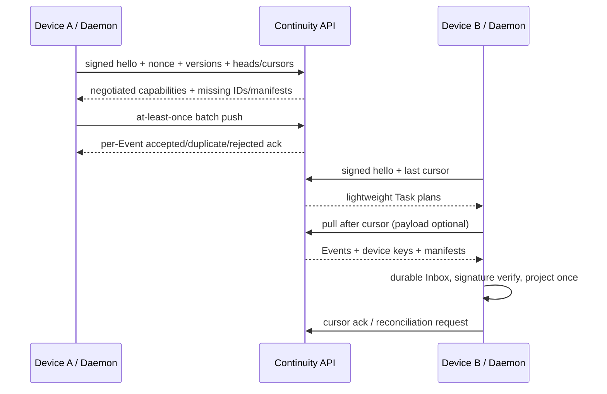

# Sync Protocol

Sync protocol `1.0` implements signed client hello, device proof and nonce replay protection, version/capability negotiation, Task head/cursor exchange, missing discovery, batch push, cursor pull, acknowledgement, Artifact manifest exchange and reconciliation. Capabilities currently include batch push, cursor pull, missing discovery, Artifact manifests, reconciliation and E2EE.

The local daemon stores Events in a crash-safe filesystem Outbox and stages pulls into bbolt before projection. It verifies remote signatures against returned active devices, replays locally after process restart, applies exponential backoff with jitter, honors retry timing, supports bandwidth throttling and user pause/resume, and reports queue/cursor/key/cache state through `status` and `doctor`.

Delivery is at least once with idempotent apply. Event and idempotency uniqueness turn retransmission into the original acknowledgement; conflicting device-sequence reuse fails closed. Network reordering and partitions preserve causal parents and provenance. WebSocket wake-up reduces latency but a reconnect always uses hello/cursor pull, so notification loss cannot lose data.
